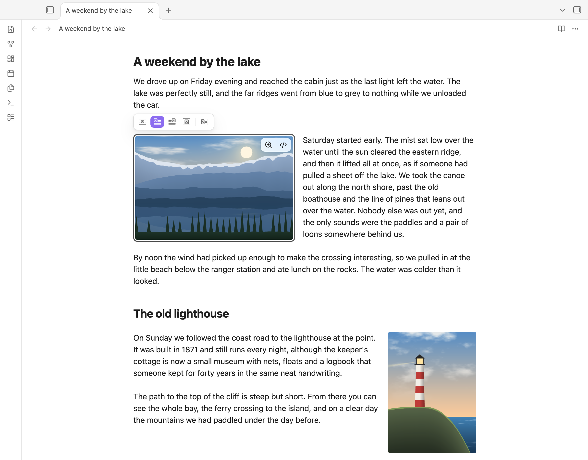

# Image Text Wrap

Word-style text wrapping for images in [Obsidian](https://obsidian.md).



- Click a picture and a small toolbar appears above it.
- One click turns text wrapping on or off and picks the side.
- Drag the picture to another place in the note, and the text flows around it wherever it lands.
- Wrapped pictures look the same in Live Preview, Reading view and exported PDFs.

You never have to type any syntax. The plugin stores your choice inside the image link, so the note stays plain Markdown.

## Using it

### The picture toolbar

Click an image in Live Preview. A toolbar appears just above it (or below it, when there is no room above):

| Button | What it does |
|---|---|
| **In line with text** | No wrapping. This is how Obsidian shows images normally. |
| **Wrap text left** | The image sits on the left, and text flows down its right side. |
| **Wrap text right** | The image sits on the right, and text flows down its left side. |
| **Top and bottom** | The image is centred on its own row, with text above and below only. |
| **Spacing** | The space between the image and the text: None, Small, Medium or Large. |

Click the highlighted wrap button again to turn wrapping off. Every change is one undo step (<kbd>Ctrl/Cmd</kbd>+<kbd>Z</kbd>).

A wrapped picture wraps wherever it sits in the text: alone on its line, on a line with other wrapped pictures, or inside a sentence, where it moves to its side and the text flows around it. This works for pictures from the web too.

The toolbar never covers Obsidian's own image controls. You can still resize an image by dragging its corner, zoom it, and open it in the image viewer.

### On a phone or tablet

Tap a picture in Live Preview. A panel opens at the bottom of the screen, above Obsidian's navigation bar and the keyboard:

| Button | What it does |
|---|---|
| **In line** | No wrapping. This is how Obsidian shows images normally. |
| **Wrap left** | The image sits on the left, and text flows down its right side. |
| **Wrap right** | The image sits on the right, and text flows down its left side. |
| **Top and bottom** | The image is centred on its own row, with text above and below only. |
| **Spacing** | None, Small, Medium or Large. Available once the image wraps text. |

Tap the highlighted wrap button again to turn wrapping off. Tapping the panel does not open the keyboard or move the cursor, and every change is one undo step. If the panel would cover the picture, the note scrolls the picture into view. To close the panel, tap anywhere in the text.

On a phone in landscape the panel is a single row. On a tablet it becomes a single row while the keyboard leaves too little room for the full panel. With a sidebar pinned on a tablet, the panel stays beside it, over the note.

### Moving an image

Press on an image and drag it. A copy follows the pointer, and a line shows where the image will land: at the start of a paragraph, heading, list, quote, table or code block, or at the end of the note.

- If the image wraps text, drop it on the left or right half of the note to choose its side. The text from that block onwards flows around it.
- If the image does not wrap text, it moves there as an ordinary image.
- Move near the top or bottom edge to scroll. Press <kbd>Esc</kbd> to cancel.
- Undo (<kbd>Ctrl/Cmd</kbd>+<kbd>Z</kbd>) puts the image back and returns to where it was, even after a drag that scrolled the note.

**On a phone or tablet:** press and hold the image for about half a second, until it is outlined in your accent colour. Then move your finger without lifting it: a copy of the image follows just above your finger, and a line shows where it will land. Lift your finger to drop it. Move near the top or bottom of the note to scroll.

- A quick tap still selects the image, and a swipe that starts on an image still scrolls the note.
- If you lift your finger without moving, the image stays where it was and is selected, so the picture panel opens.
- To undo a move, use Undo in the editing toolbar or the command palette.

### Other ways to choose a layout

The same choices are in the right-click menu of an image in Live Preview, and in the command palette (search for "wrap" or "spacing").

## Settings

| Setting | Default | What it does |
|---|---|---|
| Show the picture toolbar | On | Show the toolbar when you click an image. |
| Move images by dragging | On | Drag images to move them (on a phone or tablet: press and hold, then drag). Turn this off to use Obsidian's own image dragging, and Obsidian's own menu when you hold an image on a phone or tablet. |
| Default spacing | Medium (16 px) | The spacing an image gets when you first turn on wrapping for it. |
| Widest wrapped image | 50% | A wrapped image is shown no wider than this share of the note column. Its stored size is not changed. |

## How the layout is stored

The layout is written into the image link, between the file name and the size:

```markdown
![[photo.png|wrap-left|300]]
![[photo.png|A caption|wrap-right|gap-24|300]]

```

| Word | Meaning |
|---|---|
| (none) | In line with text |
| `wrap-left`, `wrap-right` | Wrap text on that side |
| `wrap-block` | Top and bottom |
| `gap-0`, `gap-8`, `gap-16`, `gap-24` | Spacing in pixels. Medium (16) is the default and is not written. |

The size stays last, so Obsidian keeps applying it. If you remove the plugin, your images go back to normal images at the size you gave them.

## Known limits

- Images inside tables, callouts, quotes, lists, footnotes and headings stay in line with text, also on a line that continues a list item, quote or footnote without repeating its marker. The toolbar and dragging do not act on them.
- Images in an embedded note (`![[Other note]]`) are shown with their layout, but you change them in that note itself: the toolbar and dragging do not act on them where the note is embedded.
- A dragged image lands at the start of a block, not in the middle of a paragraph, because a note is one stream of text.
- Pictures from the web (``) and pictures written into the note as data get the toolbar, but cannot be moved by dragging. Cut and paste their link instead.
- Live Preview shows a blank line as slightly taller than the paragraph spacing in Reading view, so the text beside a tall image can break at a slightly different word.
- In Reading view, right-clicking an image opens Obsidian's image viewer, so the layout choices are not in a menu there. Switch to Live Preview to change a layout.
- Very small images (about 32 pixels or less) are covered by Obsidian's own resize corner, so a click does not select them, even without this plugin. Use the commands to change their layout.
- The first time you scroll up through a long note in Reading view, text beside a wrapped image can shift once while Obsidian measures sections it has not shown yet.
- If you type layout words by hand, write them exactly as shown above, in lower case and without spaces around the `|`.
- When a picture wrapped left and one wrapped right overlap with only a narrow space between them, the text in that space can break inside words, a letter or two per line. Make one of the pictures smaller, or move one of them.
- Screen readers read an image's layout words as part of its description (its alt text), because that is where the layout is stored. Obsidian's image viewer shows only the caption or the file name.
- PDF export uses Arial unless you set a text font in Obsidian's Appearance settings, so line breaks may differ from the screen.
- On a phone or tablet, holding an image picks it up instead of opening Obsidian's image menu (Copy image, Remove image and so on). Turn off **Move images by dragging** to get that menu back.
- On Android, the Back button does not close the picture panel or cancel a drag unless Obsidian has somewhere to go back to. Tap the text to close the panel.
- If the keyboard opens while a picture is selected, the panel moves above the keyboard but does not scroll the picture into view again. On a phone in landscape, most keyboards leave less than a line of the note in view; the panel then waits until the keyboard closes.

## Privacy

Image Text Wrap makes no network requests and collects no data. Everything it does stays in your notes.

## Installing

Image Text Wrap is in Obsidian's [community plugin directory](https://community.obsidian.md/plugins/image-text-wrap). It needs Obsidian 1.13.1 or later, on desktop, phone or tablet.

1. In Obsidian, open **Settings → Community plugins**.
2. If you have never used community plugins in this vault, choose **Turn on community plugins** first (called **Exit Restricted mode** in recent versions of Obsidian). Until you do, that page has no **Browse** button.
3. Choose **Browse**, search for **Image Text Wrap**, and choose **Install**, then **Enable**.

Obsidian offers new versions as updates on the same page.

**Other ways to install** (for example, to try a version before it reaches the directory):

- With BRAT: install and turn on the community plugin **BRAT**, open its settings, choose **Add beta plugin**, and enter `tyler21richards/image-text-wrap`. Then turn on **Image Text Wrap** in Settings → Community plugins.
- By hand: download `main.js`, `manifest.json` and `styles.css` from the [latest release](https://github.com/tyler21richards/image-text-wrap/releases), put them in a new folder, `<your vault>/.obsidian/plugins/image-text-wrap/`, restart Obsidian, and turn on **Image Text Wrap** in Settings → Community plugins.

To try it out, copy `test-vault/Fixture.md`, `test-vault/Plain images.md` and the `test-vault/images` folder from this repository into a vault.

## Development

```bash
npm install
npm run build      # type-check and bundle main.js
npm test           # unit tests (node:test)
npm run lint       # ESLint, with Obsidian's plugin rules
npm run lint:css   # browser support of styles.css, as Obsidian's plugin review checks it
```

`tests/e2e/` holds a harness that drives a real Obsidian over the Chrome DevTools Protocol, with real pointer events. Set `OBSIDIAN_APP` to an Obsidian.app and run `node scripts/obsidian.mjs launch --fresh`; see the top of `scripts/obsidian.mjs` for the commands. `test-vault/Fixture.md` covers every case in the acceptance tests.

## Credits

Parts of this plugin are adapted from these MIT-licensed plugins. Their notices are in [THIRD_PARTY_NOTICES.md](THIRD_PARTY_NOTICES.md).

- [Adjustable Media](https://github.com/Yi-luo-hua/obsidian-adjustable-media) by Yi-luo-hua: pointer gesture handling, undo scroll fix, float fixes for Live Preview and Reading view.
- [Image Kit](https://github.com/haivri/obsidian-image-kit) by Robert Fleming: in-link layout grammar and toolbar patterns.
- [Image Rows and Wraps](https://github.com/Black-Manthor/image-rows-and-wraps) by Black-Manthor: gesture and PDF testing techniques.

## License

[MIT](LICENSE)
